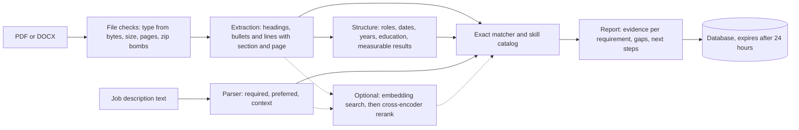

# Resume evidence matcher

Upload a resume and paste a job description. For every requirement in the job description, the app shows which resume lines prove it, which requirements have no proof, and what to do next. It never invents skills, employers, dates or numbers, and it doesn't produce a made-up "ATS score".

This is a tool for a person improving their own application. It doesn't rank or screen candidates.

[](https://github.com/rahulmurarisetty/resume-evidence-matcher/actions/workflows/ci.yml)

## What it does

1. You upload a resume (PDF or Word) and paste a job description.
2. The app reads the resume and splits it into sections (summary, experience, skills, education), keeping every bullet and the page it came from.
3. It reads each job's title, employer and dates, adds up your years of experience, and marks bullets with a measurable result such as "40+" or "5 hours to 90 minutes".
4. It reads the job description and pulls out each requirement, labeling it required, preferred or a job duty. Benefits, the company intro and legal boilerplate are skipped.
5. For each requirement it finds the skills named in it and looks for them in the resume. Requirements that ask for years are checked against the role dates.
6. If matching by meaning is on, it also looks for resume lines that say the same thing in other words.
7. Each requirement gets a result and a next step: proven in work experience, only listed in the skills section, related but worth checking, missing, or needs a person to check.

Here is the sample data engineer resume checked against the sample data engineer job (both fictional, in `samples/`). This is exact matching only, which is what you get when the ml extra isn't installed:

| Job requirement | Type | Result | What the app found |
| --- | --- | --- | --- |
| Strong Python and SQL | Required | Proven | Experience bullets: "Wrote Python data-quality checks..." and "...ran a monthly session on SQL performance tuning." |
| Hands-on experience with PySpark on Databricks | Required | Proven | Experience bullet: "Built PySpark jobs on Databricks that load claims..." |
| 5+ years of experience in data engineering | Required | Proven | Two dated roles, Jun 2019 to Feb 2022 and Mar 2022 to present, add up to about 7.5 years (in November 2026). Next step: check that enough of that time is the kind of work the job asks for. |
| Comfortable with Git and CI/CD practices | Required | Only listed | Both appear only in the skills line "Cloud and tools: AWS, Git, CI/CD, Docker, Kubernetes". Next step: if you used them at a job, add a bullet that says where. |
| Experience with dbt | Preferred | Missing | Not in the resume. Next step: leave it out unless it's true. |
| Mentor two junior engineers and review their code | Job duty | Needs a check | Names no skill, so exact matching can't assess it. |

Across all six required items, five are proven (the three above, plus Snowflake and ETL on AWS) and one is only listed.

With matching by meaning on, the models compare a duty such as "Mentor two junior engineers and review their code" with every resume line. If a line such as "Reviewed pull requests for two junior engineers..." scores above the threshold, the duty is marked adjacent and the next step quotes that line and asks you to confirm it. The real models don't run in CI, so this README doesn't show their scores.

What it never does: add skills, jobs, dates or numbers the person doesn't have, show a fake "ATS match %", or rank one candidate against another.

## Status

Version 0.2 (see [roadmap](#roadmap)). What works today:

- PDF and DOCX extraction that keeps each heading, bullet and line with its section and page. Wrapped bullets and paragraphs come back whole. Word skills tables are read row by row.
- Role parsing: title, employer, start and end month for each job, in several date formats, with "Present", "Current", "Now" and "Till date" for current roles. Total years of experience count overlapping jobs once.
- Education entries (degree, school, year) and measurable results (counts, percentages, money, durations, multipliers) in work bullets.
- A rule-based job-description parser that labels each line required, preferred or context, and picks up the title, seniority and years asked for.
- Exact skill matching against a catalog of 107 skills, with care for terms that are also ordinary words (REST, Excel, React, Go, R).
- Years requirements: "5+ years of experience" is checked against the role dates, and "7+ years with Java" against the roles that mention Java.
- Optional matching by meaning with sentence-transformers: an embedding model finds candidate lines and a cross-encoder reranks them. A requirement with no exact evidence but a related work bullet is marked `adjacent`.
- A report linking every requirement to resume evidence or marking it as a gap, with a next step written for that requirement.
- A FastAPI service with storage, deletion, automatic expiry after 24 hours, JSON logs and upload limits.
- A Streamlit screen, and a docker compose file that runs it next to the API.
- 178 tests (one needs Streamlit and is skipped without it), 98% line coverage, strict type checking, CI, and a Dockerfile with an optional CPU-only ML build.

## Quick start

Python 3.11 or newer.

macOS or Linux:

```bash
python -m venv .venv
source .venv/bin/activate
pip install -e ".[dev]"
uvicorn app.main:create_app --factory --reload
```

Windows PowerShell:

```powershell
python -m venv .venv
.venv\Scripts\Activate.ps1
pip install -e ".[dev]"
uvicorn app.main:create_app --factory --reload
```

Open http://localhost:8000/docs for interactive API docs.

### Adding matching by meaning

Install the ml extra. It brings in sentence-transformers and PyTorch.

```bash
pip install -e ".[dev,ml]"
```

On Linux without a GPU, install the CPU-only PyTorch first, so pip doesn't download several GB of CUDA libraries:

```bash
pip install torch --index-url https://download.pytorch.org/whl/cpu
pip install -e ".[dev,ml]"
```

With `SEMANTIC_MATCHING=auto` (the default), the app turns matching by meaning on when sentence-transformers is installed. The first start downloads the two models from Hugging Face, about 180 MB in all, and later starts load them from the local cache. Each report says which mode it used, in `matching_mode` and in `pipeline_version` ("0.2.0-semantic" or "0.2.0-exact").

### Streamlit screen

The screen talks to the API over HTTP, so start the API first.

```bash
pip install -e ".[ui]"
streamlit run ui/app.py
```

It opens at http://localhost:8501. Set `API_URL` if the API isn't at http://localhost:8000. The screen shows coverage for each priority, one card per requirement with its evidence and next step, the text the app read from the resume, and a button that deletes the analysis from the server.

### Docker

```bash
docker build -t resume-evidence-matcher .
docker run -p 8000:8000 resume-evidence-matcher
```

The default image does exact matching only. For matching by meaning, add `--build-arg INSTALL_ML=true`. That installs PyTorch from the CPU-only index, so the image never pulls CUDA libraries, but it is still much larger than the default image.

To run the API and the Streamlit screen together:

```bash
docker compose up --build                      # exact matching
INSTALL_ML=true docker compose up --build      # with matching by meaning
```

In Windows PowerShell, set the variable first: `$env:INSTALL_ML = "true"; docker compose up --build`.

The API is at http://localhost:8000 and the screen at http://localhost:8501. Reports live in the `app-data` volume and downloaded models in the `model-cache` volume, so a restart doesn't download them again.

## Try it

The `samples/` folder has two fictional resumes (as PDF and DOCX) and two job descriptions.

```bash
curl -X POST http://localhost:8000/api/v1/analyses \
  -F resume=@samples/generated/jordan_example_data_engineer.pdf \
  -F "job_description=<samples/jobs/data_engineer.txt"
```

`@` uploads the resume as a file. `<` sends the job description's text as a form field. In Windows PowerShell, call `curl.exe` instead of `curl` and use a backtick for line breaks.

| Method | Path | What it does |
| --- | --- | --- |
| POST | `/api/v1/analyses` | Match a resume (`resume` file) against a job description (`job_description` text). Returns the report and an id. |
| GET | `/api/v1/analyses/{id}` | Fetch a stored report. |
| DELETE | `/api/v1/analyses/{id}` | Delete a report and everything stored with it. |
| POST | `/api/v1/extract` | Show the text the app read from a resume, with sections and pages. Nothing is stored. |
| GET | `/healthz`, `/readyz` | Liveness, and readiness including the database. |

## Example output

From the sample data engineer resume against the sample data engineer job, with exact matching:

```json
"pipeline_version": "0.2.0-exact",
"matching_mode": "exact",
"coverage": {
  "required": { "total": 6, "direct": 5, "partial": 1, "gap": 0, "adjacent": 0, "not_assessed": 0 }
},
"missing_required_skills": [],
"listed_but_not_demonstrated": ["Git", "CI/CD", "Kubernetes"]
```

The profile read from the same resume in November 2026 (only the first of the two roles shown):

```json
"profile": {
  "roles": [
    {
      "title": "Senior Data Engineer",
      "employer": "Example Mutual Insurance",
      "section": "experience",
      "start": "2022-03",
      "end": null,
      "is_current": true,
      "months": 57,
      "header_span_id": "s5",
      "bullet_span_ids": ["s6", "s7", "s8", "s9", "s10"]
    }
  ],
  "total_years": 7.5,
  "education": [
    { "degree": "B.S. Computer Science", "school": "Example State University", "year": 2019, "span_ids": ["s20"] }
  ],
  "metric_bullets": ["s6", "s7", "s8", "s13"],
  "metrics": { "s6": ["5 hours to 90 minutes"], "s7": ["14"], "s8": ["40+"], "s13": ["120"] },
  "warnings": []
}
```

One requirement in detail (evidence trimmed to one line per skill):

```json
{
  "requirement": {
    "text": "Comfortable with Git and CI/CD practices",
    "priority": "required",
    "skills": ["Git", "CI/CD"]
  },
  "status": "partial",
  "skills": [
    {
      "skill": "Git",
      "strength": "listed",
      "evidence": [
        {
          "span_id": "s18",
          "text": "Cloud and tools: AWS, Git, CI/CD, Docker, Kubernetes",
          "section": "skills",
          "page": 1,
          "matched_term": "Git"
        }
      ]
    }
  ],
  "related_evidence": [],
  "years_found": null,
  "next_action": "Git and CI/CD appear only in your skills or summary. If you used them in a job or project, add a bullet that says where and what you did."
}
```

## How it works



A skill counts as demonstrated when it appears in an experience, project or certification line. It counts as listed when it appears only in the skills section, summary or header. Requirements then get one of five statuses:

| Status | Meaning |
| --- | --- |
| `direct` | Every skill the requirement names is demonstrated. For "X or Y" requirements, one is enough. For "5+ years of experience", the dated roles add up to at least that. |
| `partial` | Some skills are missing or appear only in the skills list, or the roles that mention a skill add up to fewer years than the requirement asks for (or have no dates the app can read). |
| `adjacent` | No exact evidence, but matching by meaning found a related line in experience or projects. A person has to confirm it. |
| `gap` | None of the skills appear anywhere in the resume, or the dated roles add up to fewer years than asked for. |
| `not_assessed` | The requirement names no skill the catalog knows ("Excellent communication skills") and nothing related was found, or it asks for years and no role dates could be read. A person has to check it. |

The skill catalog is `app/data/skills.json`. Each skill has terms that match case-insensitively, terms that match only with exact capitals (so "the rest of the team" isn't REST), and very short names that count only inside a list ("Python, Go, SQL" but not "go to the office").

### Roles and years

In the experience section, a line that isn't a bullet and holds a date range is a role header. These all work:

```
Senior Data Engineer, Example Mutual Insurance | Mar 2022 - Present
Example Corp - Data Analyst (2019 - 2021)
Data Analyst at Example Corp, Jun 2019 to Feb 2022
Data Analyst, Example Corp
03/2019 - 2021-12
```

The last one is a title line followed by a line with only the dates. Dates can be written "Mar 2022", "March 2022", "03/2022", "2022-03" or "2019", joined by a hyphen, an en dash or "to". The bullets that follow belong to that role until the next header or section. A projects section counts as roles only when it has dated headers, and projects never add to years of experience.

A role's months include both the start and the end month, so Jun 2019 to Feb 2022 is 33 months. Overlapping roles are merged before the months are added up, and the total is rounded to one decimal. "Present" is counted up to the current month. A date the app can't read becomes a warning in the profile, never a guess.

A requirement such as "5+ years of experience" is proven when the total reaches it and missing when it doesn't. "7+ years with Java" keeps the skill rules above, but when the roles that mention Java add up to less than 7 years it is partial at most, and the next step gives the number the resume shows.

### Matching by meaning

Exact matching misses work described in other words. When matching by meaning is on, an embedding model (all-MiniLM-L6-v2 by default) turns each resume line and each requirement into a vector, and the 8 closest lines by cosine similarity become candidates. A cross-encoder (ms-marco-MiniLM-L6-v2) then reads the requirement and each candidate together and scores the pair from 0 to 1. Lines scoring 0.5 or more are returned as `related_evidence`, each with its section, page and score.

Related evidence never replaces exact evidence. A requirement with exact evidence keeps its status, and lines that are already exact evidence aren't repeated. A requirement that would be a gap or not assessed becomes `adjacent` when a related line comes from experience or projects. Its next step quotes that line and asks the person to confirm it really shows the requirement, and to use the job description's wording only where it is true. The named skill still counts as missing in `missing_required_skills`. A requirement that asks only for years ("5+ years of experience") is never marked adjacent, because a similar bullet doesn't add years.

If a model fails while scoring, the report falls back to exact matching and says so in its warnings.

## Configuration

Settings come from environment variables or a `.env` file. See `.env.example`.

| Variable | Default | Purpose |
| --- | --- | --- |
| `DATABASE_URL` | `sqlite:///./data/app.db` | Any SQLAlchemy URL. Postgres arrives in v1.0. |
| `MAX_UPLOAD_MB` | `5` | Largest resume file accepted. |
| `MAX_PDF_PAGES` | `10` | Longest PDF accepted. |
| `MAX_JD_CHARS` | `20000` | Longest job description accepted. |
| `RETENTION_HOURS` | `24` | Stored reports are deleted after this. |
| `CORS_ORIGINS` | `http://localhost:8501` | Browser origins allowed to call the API. |
| `LOG_LEVEL` | `INFO` | Log level for the JSON logs. |
| `SEMANTIC_MATCHING` | `auto` | `off`, `on` or `auto`. `auto` turns matching by meaning on only when sentence-transformers is installed. `on` stops the app at startup if the models can't be loaded. |
| `SEMANTIC_TOP_K` | `8` | Resume lines the embedding search passes to the reranker for each requirement. |
| `SEMANTIC_THRESHOLD` | `0.5` | Reranker score, from 0 to 1, that a line needs to count as related. |
| `EMBEDDING_MODEL` | `sentence-transformers/all-MiniLM-L6-v2` | Embedding model for the first search. |
| `RERANK_MODEL` | `cross-encoder/ms-marco-MiniLM-L6-v2` | Cross-encoder that scores each candidate line. |
| `ANTHROPIC_API_KEY` | empty | Not used until v0.3. |

The Streamlit screen reads `API_URL` (default `http://localhost:8000`) from its own environment. The Docker build takes `INSTALL_ML` (`false` or `true`), and docker compose passes it through.

## Privacy and data handling

- Uploaded files are parsed in memory and never written to disk. Only the report and a SHA-256 hash of the file are stored.
- Reports expire after `RETENTION_HOURS` and can be deleted at any time with `DELETE /api/v1/analyses/{id}` or the button on the Streamlit screen.
- Logs record request ids, paths, status codes and timings. They never contain resume or job-description text.
- Matching by meaning runs both models inside the API process. Resume and job-description text are never sent to another service. The only outside request is the one-time model download from Hugging Face.
- The file type is decided from the file's bytes, not its name. DOCX archives are checked for unpacked size before opening.
- Every resume in this repository is fictional. Real resumes never go in the repo or the test set.

## Development

```bash
pytest                      # tests, with warnings treated as errors
pytest --cov=app            # with coverage
ruff check . && ruff format --check .
mypy app                    # strict mode
python scripts/make_samples.py   # rebuild samples/generated from samples/resumes
```

The tests never load a real model. `tests/fakes.py` has a deterministic encoder (hashed word stems with a small synonym table) and reranker (the share of the requirement's words a line covers), and the test settings set `SEMANTIC_MATCHING=off`. The Streamlit screen test runs only when Streamlit is installed.

Dependencies are pinned with hashes in `requirements.lock` (runtime) and `requirements-dev.lock` (dev). After changing `pyproject.toml`, regenerate them:

```bash
uv pip compile pyproject.toml --universal --python-version 3.11 --generate-hashes -o requirements.lock
uv pip compile pyproject.toml --extra dev --universal --python-version 3.11 --generate-hashes -o requirements-dev.lock
```

The ml and ui extras are left out of the lock files. PyTorch has to come from a platform-specific index (the CPU-only one in the Docker image), which a universal lock can't express.

```
app/
  api/          routes, request and response schemas, error handling
  services/     extraction, job-description parsing, skill catalog, structure (roles,
                years, education, measurable results), matching, matching by meaning
  storage/      database setup and repository
  data/         skills.json
  models.py     data contracts shared by the pipeline and the API
ui/             Streamlit screen and its Dockerfile
tests/
  unit/  integration/
  builders.py   builds realistic PDF and DOCX resumes for tests and samples
  fakes.py      deterministic stand-ins for the embedding model and reranker
samples/        fictional resumes and job descriptions
scripts/        sample generation
docker-compose.yml   the API and the Streamlit screen together
```

## Limitations

- Matching by meaning needs the ml extra and about 180 MB of model downloads on first start. Both default models were trained on English text, so they do little for resumes in other languages.
- The real models never run in CI. The tests use a fake encoder and reranker, so the default threshold of 0.5 hasn't been checked against real resumes yet. The v0.4 evaluation set is meant to tune it.
- Without the ml extra, matching is exact. "Built REST endpoints" counts for REST APIs, but "designed services other teams call" doesn't count for anything.
- Skills outside the 107-skill catalog are marked `not_assessed` (or `adjacent` with matching by meaning), not as gaps.
- Total years count every dated role in the experience section, whatever the field. Five years of any work meets "5+ years of experience in data engineering", which is why the next step asks the person to check the kind of work.
- A role is found only when a date range sits on its header line or on the line right after it. Layouts with the employer on its own line or the dates above the title can lose the employer or title, and roles without dates aren't counted. A year without a month counts from January of the start year to December of the end year, with a warning.
- Measurable results are found with patterns. Numbers written as words ("two teams") are missed, and a number right after a capitalized word ("Python 3", "Tier 1") is skipped as a likely version.
- Education parsing is best effort. It looks for words such as "University", "College", "B.S." or "Master".
- The Streamlit screen's helpers are tested against the API, but the screen itself only gets a smoke test when Streamlit is installed, and CI doesn't install it.
- The ml extra isn't hash-locked, so an image built with `INSTALL_ML=true` gets whatever versions are current at build time.
- Two-column PDFs are read in the order the PDF stores its text. That's usually column by column, but not always.
- Scanned resumes (images of text) and old `.doc` files are rejected with a message saying why.
- The job-description parser is rule-based. Unusual layouts can put a line in the wrong category.
- There's no login, rate limiting or malware scanning yet. Don't run this at a public URL with real resumes before v1.0.

## Roadmap

| Version | Focus |
| --- | --- |
| 0.1 | Extraction, job-description parsing, exact matching, API, tests, CI (done) |
| 0.2 | Matching by meaning with sentence-transformers (search, then rerank) and the adjacent status. Each job's title, employer, dates and measurable results, years of experience, and years requirements. Streamlit screen and docker compose. (done, this release) |
| 0.3 | Claude-based job-description parsing and bullet rewrites behind the same interfaces. A fact checker that rejects any rewrite adding a number, date, employer or tool not in the source line. Side-by-side edits, correction of extraction mistakes, and DOCX export. |
| 0.4 | Hand-labeled evaluation set of fictional resumes and job descriptions. Extraction accuracy, requirement labeling precision and recall, evidence recall at 3, gap accuracy and hallucination rate, compared across versions. Tuning of the matching-by-meaning threshold. |
| 1.0 | Live deployment of the CPU-only ML image: login, Postgres with migrations, Azure hosting, malware scanning, rate limits, demo video. |

## License

AGPL-3.0-or-later. PDF extraction uses [PyMuPDF](https://pymupdf.readthedocs.io/), which is licensed under the AGPL, so this project is too. If you run a modified version as a public service, you must make its source available to its users.
