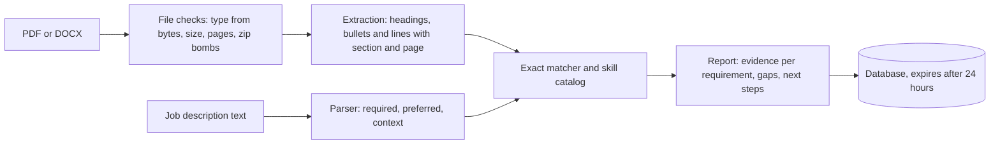

# Resume evidence matcher

Upload a resume and paste a job description. For every requirement in the job description, the app shows which resume lines prove it, which requirements have no proof, and what to do next. It never invents skills, employers, dates or numbers, and it doesn't produce a made-up "ATS score".

This is a tool for a person improving their own application. It doesn't rank or screen candidates.

[](https://github.com/rahulmurarisetty/resume-evidence-matcher/actions/workflows/ci.yml)

## What it does

1. You upload a resume (PDF or Word) and paste a job description.
2. The app reads the resume and splits it into sections (summary, experience, skills, education), keeping every bullet and the page it came from.
3. It reads the job description and pulls out each requirement, labeling it required, preferred or a job duty. Benefits, the company intro and legal boilerplate are skipped.
4. For each requirement it finds the skills named in it and looks for them in the resume.
5. Each requirement gets a result and a next step: proven in work experience, only listed in the skills section, missing, or needs a person to check.

Here is the sample data engineer resume checked against the sample data engineer job (both fictional, in `samples/`):

| Job requirement | Type | Result | What the app found |
| --- | --- | --- | --- |
| Strong Python and SQL | Required | Proven | Experience bullets: "Wrote Python data-quality checks..." and "...ran a monthly session on SQL performance tuning." |
| Hands-on experience with PySpark on Databricks | Required | Proven | Experience bullet: "Built PySpark jobs on Databricks that load claims..." |
| Comfortable with Git and CI/CD practices | Required | Only listed | Both appear only in the skills line "Cloud and tools: AWS, Git, CI/CD, Docker, Kubernetes". Next step: if you used them at a job, add a bullet that says where. |
| 5+ years of experience in data engineering | Required | Needs a check | Years aren't calculated from job dates yet. |
| Experience with dbt | Preferred | Missing | Not in the resume. Next step: leave it out unless it's true. |

Across all six required items, four are proven (the two above, plus Snowflake and ETL on AWS), one is only listed, and one needs a person to check.

What it never does: add skills, jobs, dates or numbers the person doesn't have, show a fake "ATS match %", or rank one candidate against another.

## Status

Version 0.1 (see [roadmap](#roadmap)). What works today:

- PDF and DOCX extraction that keeps each heading, bullet and line with its section and page. Wrapped bullets and paragraphs come back whole. Word skills tables are read row by row.
- A rule-based job-description parser that labels each line required, preferred or context, and picks up the title, seniority and years asked for.
- Exact skill matching against a catalog of 107 skills, with care for terms that are also ordinary words (REST, Excel, React, Go, R).
- A report linking every requirement to resume evidence or marking it as a gap, with a next step written for that requirement.
- A FastAPI service with storage, deletion, automatic expiry after 24 hours, JSON logs and upload limits.
- 68 tests (96% line coverage), strict type checking, CI and a Dockerfile.

## Quick start

Python 3.11 or newer.

macOS or Linux:

```bash
python -m venv .venv
source .venv/bin/activate
pip install -e ".[dev]"
uvicorn app.main:create_app --factory --reload
```

Windows PowerShell:

```powershell
python -m venv .venv
.venv\Scripts\Activate.ps1
pip install -e ".[dev]"
uvicorn app.main:create_app --factory --reload
```

Open http://localhost:8000/docs for interactive API docs.

With Docker:

```bash
docker build -t resume-evidence-matcher .
docker run -p 8000:8000 resume-evidence-matcher
```

## Try it

The `samples/` folder has two fictional resumes (as PDF and DOCX) and two job descriptions.

```bash
curl -X POST http://localhost:8000/api/v1/analyses \
  -F resume=@samples/generated/jordan_example_data_engineer.pdf \
  -F "job_description=<samples/jobs/data_engineer.txt"
```

`@` uploads the resume as a file. `<` sends the job description's text as a form field. In Windows PowerShell, call `curl.exe` instead of `curl` and use a backtick for line breaks.

| Method | Path | What it does |
| --- | --- | --- |
| POST | `/api/v1/analyses` | Match a resume (`resume` file) against a job description (`job_description` text). Returns the report and an id. |
| GET | `/api/v1/analyses/{id}` | Fetch a stored report. |
| DELETE | `/api/v1/analyses/{id}` | Delete a report and everything stored with it. |
| POST | `/api/v1/extract` | Show the text the app read from a resume, with sections and pages. Nothing is stored. |
| GET | `/healthz`, `/readyz` | Liveness, and readiness including the database. |

## Example output

From the sample data engineer resume against the sample data engineer job:

```json
"coverage": {
  "required": { "total": 6, "direct": 4, "partial": 1, "gap": 0, "not_assessed": 1 }
},
"missing_required_skills": [],
"listed_but_not_demonstrated": ["Git", "CI/CD", "Kubernetes"]
```

One requirement in detail (evidence trimmed to one line per skill):

```json
{
  "requirement": {
    "text": "Comfortable with Git and CI/CD practices",
    "priority": "required",
    "skills": ["Git", "CI/CD"]
  },
  "status": "partial",
  "skills": [
    {
      "skill": "Git",
      "strength": "listed",
      "evidence": [
        {
          "span_id": "s18",
          "text": "Cloud and tools: AWS, Git, CI/CD, Docker, Kubernetes",
          "section": "skills",
          "page": 1,
          "matched_term": "Git"
        }
      ]
    }
  ],
  "next_action": "Git and CI/CD appear only in your skills or summary. If you used them in a job or project, add a bullet that says where and what you did."
}
```

## How it works



A skill counts as demonstrated when it appears in an experience, project or certification line. It counts as listed when it appears only in the skills section, summary or header. Requirements then get one of four statuses:

| Status | Meaning |
| --- | --- |
| `direct` | Every skill the requirement names is demonstrated. For "X or Y" requirements, one is enough. |
| `partial` | Some skills are missing, or appear only in the skills list. |
| `gap` | None of the skills appear anywhere in the resume. |
| `not_assessed` | The requirement names no skill the catalog knows ("Excellent communication skills", "5+ years of experience"). A person has to check it. |

The skill catalog is `app/data/skills.json`. Each skill has terms that match case-insensitively, terms that match only with exact capitals (so "the rest of the team" isn't REST), and very short names that count only inside a list ("Python, Go, SQL" but not "go to the office").

## Configuration

Settings come from environment variables or a `.env` file. See `.env.example`.

| Variable | Default | Purpose |
| --- | --- | --- |
| `DATABASE_URL` | `sqlite:///./data/app.db` | Any SQLAlchemy URL. Postgres arrives in v1.0. |
| `MAX_UPLOAD_MB` | `5` | Largest resume file accepted. |
| `MAX_PDF_PAGES` | `10` | Longest PDF accepted. |
| `MAX_JD_CHARS` | `20000` | Longest job description accepted. |
| `RETENTION_HOURS` | `24` | Stored reports are deleted after this. |
| `CORS_ORIGINS` | `http://localhost:8501` | Browser origins allowed to call the API. |
| `LOG_LEVEL` | `INFO` | Log level for the JSON logs. |
| `ANTHROPIC_API_KEY` | empty | Not used until v0.3. |

## Privacy and data handling

- Uploaded files are parsed in memory and never written to disk. Only the report and a SHA-256 hash of the file are stored.
- Reports expire after `RETENTION_HOURS` and can be deleted at any time with `DELETE /api/v1/analyses/{id}`.
- Logs record request ids, paths, status codes and timings. They never contain resume or job-description text.
- The file type is decided from the file's bytes, not its name. DOCX archives are checked for unpacked size before opening.
- Every resume in this repository is fictional. Real resumes never go in the repo or the test set.

## Development

```bash
pytest                      # tests, with warnings treated as errors
pytest --cov=app            # with coverage
ruff check . && ruff format --check .
mypy app                    # strict mode
python scripts/make_samples.py   # rebuild samples/generated from samples/resumes
```

Dependencies are pinned with hashes in `requirements.lock` (runtime) and `requirements-dev.lock` (dev). After changing `pyproject.toml`, regenerate them:

```bash
uv pip compile pyproject.toml --universal --python-version 3.11 --generate-hashes -o requirements.lock
uv pip compile pyproject.toml --extra dev --universal --python-version 3.11 --generate-hashes -o requirements-dev.lock
```

```
app/
  api/          routes, request and response schemas, error handling
  services/     extraction, job-description parsing, skill catalog, matching
  storage/      database setup and repository
  data/         skills.json
  models.py     data contracts shared by the pipeline and the API
tests/
  unit/  integration/
  builders.py   builds realistic PDF and DOCX resumes for tests and samples
samples/        fictional resumes and job descriptions
scripts/        sample generation
```

## Limitations

- Matching is exact. "Built REST endpoints" counts for REST APIs, but "designed services other teams call" doesn't count for anything yet. v0.2 adds matching by meaning.
- Skills outside the 107-skill catalog are marked `not_assessed`, not as gaps.
- Total years of experience aren't calculated from job dates yet.
- Two-column PDFs are read in the order the PDF stores its text. That's usually column by column, but not always.
- Scanned resumes (images of text) and old `.doc` files are rejected with a message saying why.
- The job-description parser is rule-based. Unusual layouts can put a line in the wrong category.
- There's no login, rate limiting or malware scanning yet. Don't run this at a public URL with real resumes before v1.0.

## Roadmap

| Version | Focus |
| --- | --- |
| 0.1 | Extraction, job-description parsing, exact matching, API, tests, CI (this release) |
| 0.2 | Matching by meaning with sentence-transformers (search, then rerank). Parse each job's title, employer, dates and measurable results. Streamlit screen. |
| 0.3 | Claude-based job-description parsing and bullet rewrites behind the same interfaces. A fact checker that rejects any rewrite adding a number, date, employer or tool not in the source line. Side-by-side edits, correction of extraction mistakes, and DOCX export. |
| 0.4 | Hand-labeled evaluation set of fictional resumes and job descriptions. Extraction accuracy, requirement labeling precision and recall, evidence recall at 3, gap accuracy and hallucination rate, compared across versions. |
| 1.0 | Live deployment: login, Postgres with migrations, CPU-only PyTorch image, Azure hosting, malware scanning, rate limits, demo video. |

## License

AGPL-3.0-or-later. PDF extraction uses [PyMuPDF](https://pymupdf.readthedocs.io/), which is licensed under the AGPL, so this project is too. If you run a modified version as a public service, you must make its source available to its users.
