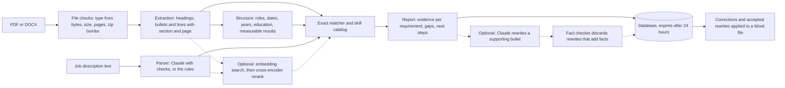

# Resume evidence matcher

Upload a resume and paste a job description. For every requirement in the job description, the app shows which resume lines prove it, which requirements have no proof, and what to do next. With a Claude key it also suggests clearer wording for the bullets that prove a requirement, and a rule-based fact checker throws away any suggestion that adds a fact. You fix lines the app read wrongly, accept the rewrites you want and download a plain Word file. It never invents skills, employers, dates or numbers, and it doesn't produce a made-up "ATS score".

This is a tool for a person improving their own application. It doesn't rank or screen candidates.

[](https://github.com/rahulmurarisetty/resume-evidence-matcher/actions/workflows/ci.yml)

## What it does

1. You upload a resume (PDF or Word) and paste a job description.
2. The app reads the resume and splits it into sections (summary, experience, skills, education), keeping every bullet and the page it came from.
3. It reads each job's title, employer and dates, adds up your years of experience, and marks bullets with a measurable result such as "40+" or "5 hours to 90 minutes".
4. It reads the job description and pulls out each requirement, labeling it required, preferred or a job duty. Benefits, the company intro and legal boilerplate are skipped.
5. For each requirement it finds the skills named in it and looks for them in the resume. Requirements that ask for years are checked against the role dates.
6. If matching by meaning is on, it also looks for resume lines that say the same thing in other words.
7. Each requirement gets a result and a next step: proven in work experience, only listed in the skills section, related but worth checking, missing, or needs a person to check.
8. With a Claude key, Claude reads the job description instead of the rules. Every requirement it returns must appear word for word in the job description, or it is dropped. If Claude fails, the rules take over and the report says so.
9. For a requirement the resume supports, you can ask for rewrites of the bullet that supports it. Claude suggests up to two, and the fact checker discards any that add a number, date, name, tool, certification or claim the bullet doesn't make.
10. You accept or reject each suggestion, fix any line the app read wrongly, and answer a question for each missing requirement ("Have you used dbt? If yes, where, and what did you build with it?"). Answers are kept with the analysis and never put into the resume.
11. You download a single-column Word file: your lines in their original order with your corrections and accepted rewrites, and a list of every change.

Here is the sample data engineer resume checked against the sample data engineer job (both fictional, in `samples/`). This is exact matching with the rule-based parser, which is what you get without the ml extra and without a Claude key:

| Job requirement | Type | Result | What the app found |
| --- | --- | --- | --- |
| Strong Python and SQL | Required | Proven | Experience bullets: "Wrote Python data-quality checks..." and "...ran a monthly session on SQL performance tuning." |
| Hands-on experience with PySpark on Databricks | Required | Proven | Experience bullet: "Built PySpark jobs on Databricks that load claims..." |
| 5+ years of experience in data engineering | Required | Proven | Two dated roles, Jun 2019 to Feb 2022 and Mar 2022 to present, add up to about 7.5 years (in November 2026). Next step: check that enough of that time is the kind of work the job asks for. |
| Comfortable with Git and CI/CD practices | Required | Only listed | Both appear only in the skills line "Cloud and tools: AWS, Git, CI/CD, Docker, Kubernetes". Next step: if you used them at a job, add a bullet that says where. |
| Experience with dbt | Preferred | Missing | Not in the resume. Next step: leave it out unless it's true. |
| Mentor two junior engineers and review their code | Job duty | Needs a check | Names no skill, so exact matching can't assess it. |

Across all six required items, five are proven (the three above, plus Snowflake and ETL on AWS) and one is only listed.

With matching by meaning on, the models compare a duty such as "Mentor two junior engineers and review their code" with every resume line. If a line such as "Reviewed pull requests for two junior engineers..." scores above the threshold, the duty is marked adjacent and the next step quotes that line and asks you to confirm it. The real models don't run in CI, so this README doesn't show their scores.

The fact checker is deterministic, so its verdicts can be shown exactly. These are its real results for rewrites of the sample bullet "Scheduled and monitored 40+ Airflow DAGs, adding SLA alerts that reduced missed morning loads from weekly to roughly once a quarter." The rewrites were written by hand for this table. No model output appears in this README, because no real API calls were made while building v0.3.

| Candidate rewrite | Verdict | What the checker found |
| --- | --- | --- |
| Orchestrated 40 or more Airflow DAGs with SLA alerts, cutting missed morning loads from weekly to roughly once a quarter. | Kept | Nothing new: "40 or more" is "40+" and "cutting" is the same kind of result as "reduced". |
| Monitored 40+ Airflow DAGs with SLA alerts. | Kept | Nothing new. Trimming is allowed. |
| Orchestrated 400+ Airflow DAGs with SLA alerts, cutting missed morning loads from weekly to roughly once a quarter. | Discarded | The number "400+" isn't in the original line. |
| Led a team of 4 that scheduled 40+ Airflow and Prefect DAGs with SLA alerts. | Discarded | "Led" claims more responsibility, "4" is a new number and "Prefect" is a new product name. |
| Scheduled 40+ Airflow DAGs across the company, eliminating missed morning loads. | Discarded | "across the company" and "eliminating" widen the claim. |

What it never does: add skills, jobs, dates or numbers the person doesn't have, put an unchecked rewrite in front of the person, change or store the uploaded file, show a fake "ATS match %", or rank one candidate against another.

## Status

Version 0.4 (see [roadmap](#roadmap)). What works today:

- PDF and DOCX extraction that keeps each heading, bullet and line with its section and page. Wrapped bullets and paragraphs come back whole. Word skills tables are read row by row.
- Role parsing: title, employer, start and end month for each job, in several date formats, with "Present", "Current", "Now" and "Till date" for current roles. Total years of experience count overlapping jobs once.
- Education entries (degree, school, year) and measurable results (counts, percentages, money, durations, multipliers) in work bullets.
- A rule-based job-description parser that labels each line required, preferred or context, and picks up the title, seniority and years asked for.
- A Claude-based job-description parser behind the same interface, with checks on everything it returns and a fallback to the rules. Skills outside the catalog are kept as free-text skills and matched as whole phrases.
- Exact skill matching against a catalog of 107 skills, with care for terms that are also ordinary words (REST, Excel, React, Go, R).
- Years requirements: "5+ years of experience" is checked against the role dates, and "7+ years with Java" against the roles that mention Java.
- Optional matching by meaning with sentence-transformers: an embedding model finds candidate lines and a cross-encoder reranks them. A requirement with no exact evidence but a related work bullet is marked `adjacent`.
- A report linking every requirement to resume evidence or marking it as a gap, with a next step written for that requirement.
- Rewrite suggestions from Claude for the bullets that support a requirement, each one passed through a deterministic fact checker, with a cap per analysis.
- Corrections of lines the app read wrongly, a gap question for each missing or adjacent requirement, a Word export and a list of every change.
- A FastAPI service with storage, deletion, automatic expiry after 24 hours, JSON logs and upload limits.
- A Streamlit screen, and a docker compose file that runs it next to the API.
- An evaluation against a hand-labeled set of fictional resumes and job descriptions (`python -m evals.run`), with its results in [evals/results/REPORT.md](evals/results/REPORT.md) and a check in CI that fails when a metric drops below its threshold. See [Evaluation](#evaluation).
- 455 tests (one needs Streamlit and is skipped without it), 99% line coverage of `app/`, strict type checking of `app/` and `evals/`, CI, and a Dockerfile with an optional CPU-only ML build. No test calls the Anthropic API.

## Quick start

Python 3.11 or newer.

macOS or Linux:

```bash
python -m venv .venv
source .venv/bin/activate
pip install -e ".[dev]"
uvicorn app.main:create_app --factory --reload
```

Windows PowerShell:

```powershell
python -m venv .venv
.venv\Scripts\Activate.ps1
pip install -e ".[dev]"
uvicorn app.main:create_app --factory --reload
```

Open http://localhost:8000/docs for interactive API docs.

### Adding matching by meaning

Install the ml extra. It brings in sentence-transformers and PyTorch.

```bash
pip install -e ".[dev,ml]"
```

On Linux without a GPU, install the CPU-only PyTorch first, so pip doesn't download several GB of CUDA libraries:

```bash
pip install torch --index-url https://download.pytorch.org/whl/cpu
pip install -e ".[dev,ml]"
```

With `SEMANTIC_MATCHING=auto` (the default), the app turns matching by meaning on when sentence-transformers is installed. The first start downloads the two models from Hugging Face, about 180 MB in all, and later starts load them from the local cache. Each report says which mode it used, in `matching_mode` and in `pipeline_version` ("0.4.0-semantic" or "0.4.0-exact").

### Turning on Claude

Claude reads job descriptions and writes rewrite suggestions. It is off until you give the API a key. Copy `.env.example` to `.env` in the project folder and set the key there:

```bash
cp .env.example .env
# then edit .env:
# ANTHROPIC_API_KEY=your key
```

`.env` is listed in `.gitignore` and `.dockerignore`, so the key stays on your machine. Never put a real key in `.env.example`, a commit, an issue or a log. The app keeps the key in a secret field that doesn't print, and never writes it to logs, errors or reports.

With `LLM_ENABLED=auto` (the default), Claude is on when a key is set and off when it isn't. `LLM_ENABLED=on` stops the app at startup if the key is missing, and `off` ignores any key. Without Claude, the rule-based parser reads the job description and asking for suggestions returns 409 with a message that says how to turn them on. Everything else works the same.

Each report says which parser read the job description, in `job_parser`:

```json
"job_parser": {
  "name": "claude",
  "prompt_version": "jd_parse_v1",
  "model": "claude-haiku-5-5",
  "fallback_reason": null,
  "dropped_requirements": 0
}
```

When Claude was tried and failed, `name` is "rules" and `fallback_reason` is `timeout`, `api_error` or `invalid_output`.

### Streamlit screen

The screen talks to the API over HTTP, so start the API first.

```bash
pip install -e ".[ui]"
streamlit run ui/app.py
```

It opens at http://localhost:8501. Set `API_URL` if the API isn't at http://localhost:8000. The screen shows coverage for each priority and one card per requirement with its evidence and next step. Cards for requirements the resume supports have a "Suggest rewrites" button, and each suggestion shows your line and the rewrite side by side with Accept and Reject buttons. Cards for missing requirements show their question with an answer box. Below the report are a form for fixing lines the app read wrongly, the list of your changes, a "Download Word file" button and a button that deletes the analysis from the server.

### Docker

```bash
docker build -t resume-evidence-matcher .
docker run -p 8000:8000 resume-evidence-matcher
```

The default image does exact matching only. For matching by meaning, add `--build-arg INSTALL_ML=true`. That installs PyTorch from the CPU-only index, so the image never pulls CUDA libraries, but it is still much larger than the default image.

To run the API and the Streamlit screen together:

```bash
docker compose up --build                      # exact matching
INSTALL_ML=true docker compose up --build      # with matching by meaning
```

In Windows PowerShell, set the variable first: `$env:INSTALL_ML = "true"; docker compose up --build`.

The API is at http://localhost:8000 and the screen at http://localhost:8501. Reports live in the `app-data` volume and downloaded models in the `model-cache` volume, so a restart doesn't download them again. Compose passes `ANTHROPIC_API_KEY` and `LLM_ENABLED` from your shell or the local `.env` file to the API, so Claude stays off unless you set a key.

## Try it

The `samples/` folder has two fictional resumes (as PDF and DOCX) and two job descriptions.

```bash
curl -X POST http://localhost:8000/api/v1/analyses \
  -F resume=@samples/generated/jordan_example_data_engineer.pdf \
  -F "job_description=<samples/jobs/data_engineer.txt"
```

`@` uploads the resume as a file. `<` sends the job description's text as a form field. In Windows PowerShell, call `curl.exe` instead of `curl` and use a backtick for line breaks.

| Method | Path | What it does |
| --- | --- | --- |
| POST | `/api/v1/analyses` | Match a resume (`resume` file) against a job description (`job_description` text). Returns the report and an id. |
| GET | `/api/v1/analyses/{id}` | Fetch a stored report. |
| DELETE | `/api/v1/analyses/{id}` | Delete a report and everything stored with it. |
| POST | `/api/v1/analyses/{id}/suggestions` | Ask Claude for rewrites. Send `{"requirement_ids": ["r6"]}` for chosen requirements, or no body for every eligible requirement that has none yet. Returns the suggestions that passed the fact checker, how many were discarded, which requirements were skipped and why, and the remaining allowance. 409 when Claude is off or the allowance is used up. |
| GET | `/api/v1/analyses/{id}/suggestions` | Every suggestion with its status (`proposed`, `accepted`, `rejected`), source line, prompt version and model. |
| POST | `/api/v1/analyses/{id}/suggestions/{sid}/accept` | Accept a suggestion. One accepted rewrite per line. |
| POST | `/api/v1/analyses/{id}/suggestions/{sid}/reject` | Reject a suggestion, or undo an accept. |
| GET | `/api/v1/analyses/{id}/spans` | The lines the app read, each with its current text and whether it was corrected. |
| PATCH | `/api/v1/analyses/{id}/spans/{span_id}` | Correct a line the app read wrongly: `{"text": "..."}`. Sending the original text removes the correction. |
| GET | `/api/v1/analyses/{id}/gap-questions` | One question per missing or adjacent requirement, with any answer. |
| PUT | `/api/v1/analyses/{id}/gap-answers/{requirement_id}` | Save an answer: `{"answer": "..."}`. An empty answer removes it. |
| GET | `/api/v1/analyses/{id}/export.docx` | The Word file with corrections and accepted rewrites applied. |
| GET | `/api/v1/analyses/{id}/export/changes` | Every change in the export: `before`, `after` and `kind` (`correction` or `rewrite`). |
| POST | `/api/v1/extract` | Show the text the app read from a resume, with sections and pages. Nothing is stored. |
| GET | `/healthz`, `/readyz` | Liveness, and readiness including the database. |

With an analysis id from the first call:

```bash
curl -X POST http://localhost:8000/api/v1/analyses/$ID/suggestions \
  -H "Content-Type: application/json" -d '{"requirement_ids": ["r6"]}'
curl -X PATCH http://localhost:8000/api/v1/analyses/$ID/spans/s3 \
  -H "Content-Type: application/json" -d '{"text": "Data engineer with six years of experience."}'
curl -o resume.docx http://localhost:8000/api/v1/analyses/$ID/export.docx
```

Analyses made by v0.2 didn't store their lines, so their spans, export and suggestions return 409 with a message asking to run the analysis again.

## Example output

From the sample data engineer resume against the sample data engineer job, with exact matching:

```json
"pipeline_version": "0.4.0-exact",
"matching_mode": "exact",
"job_parser": { "name": "rules", "prompt_version": null, "model": null, "fallback_reason": null, "dropped_requirements": 0 },
"coverage": {
  "required": { "total": 6, "direct": 5, "partial": 1, "gap": 0, "adjacent": 0, "not_assessed": 0 }
},
"missing_required_skills": [],
"listed_but_not_demonstrated": ["Git", "CI/CD", "Kubernetes"]
```

The profile read from the same resume in November 2026 (only the first of the two roles shown):

```json
"profile": {
  "roles": [
    {
      "title": "Senior Data Engineer",
      "employer": "Example Mutual Insurance",
      "section": "experience",
      "start": "2022-03",
      "end": null,
      "is_current": true,
      "months": 57,
      "header_span_id": "s5",
      "bullet_span_ids": ["s6", "s7", "s8", "s9", "s10"]
    }
  ],
  "total_years": 7.5,
  "education": [
    { "degree": "B.S. Computer Science", "school": "Example State University", "year": 2019, "span_ids": ["s20"] }
  ],
  "metric_bullets": ["s6", "s7", "s8", "s13"],
  "metrics": { "s6": ["5 hours to 90 minutes"], "s7": ["14"], "s8": ["40+"], "s13": ["120"] },
  "warnings": []
}
```

One requirement in detail (evidence trimmed to one line per skill):

```json
{
  "requirement": {
    "text": "Comfortable with Git and CI/CD practices",
    "priority": "required",
    "skills": ["Git", "CI/CD"],
    "free_text_skills": []
  },
  "status": "partial",
  "skills": [
    {
      "skill": "Git",
      "strength": "listed",
      "evidence": [
        {
          "span_id": "s18",
          "text": "Cloud and tools: AWS, Git, CI/CD, Docker, Kubernetes",
          "section": "skills",
          "page": 1,
          "matched_term": "Git"
        }
      ]
    }
  ],
  "related_evidence": [],
  "years_found": null,
  "next_action": "Git and CI/CD appear only in your skills or summary. If you used them in a job or project, add a bullet that says where and what you did."
}
```

## How it works



A skill counts as demonstrated when it appears in an experience, project or certification line. It counts as listed when it appears only in the skills section, summary or header. Requirements then get one of five statuses:

| Status | Meaning |
| --- | --- |
| `direct` | Every skill the requirement names is demonstrated. For "X or Y" requirements, one is enough. For "5+ years of experience", the dated roles add up to at least that. |
| `partial` | Some skills are missing or appear only in the skills list, or the roles that mention a skill add up to fewer years than the requirement asks for (or have no dates the app can read). |
| `adjacent` | No exact evidence, but matching by meaning found a related line in experience or projects. A person has to confirm it. |
| `gap` | None of the skills appear anywhere in the resume, or the dated roles add up to fewer years than asked for. |
| `not_assessed` | The requirement names no skill the catalog knows ("Excellent communication skills") and nothing related was found, or it asks for years and no role dates could be read. A person has to check it. |

The skill catalog is `app/data/skills.json`. Each skill has terms that match case-insensitively, terms that match only with exact capitals (so "the rest of the team" isn't REST), and very short names that count only inside a list ("Python, Go, SQL" but not "go to the office").

### Roles and years

In the experience section, a line that isn't a bullet and holds a date range is a role header. These all work:

```
Senior Data Engineer, Example Mutual Insurance | Mar 2022 - Present
Example Corp - Data Analyst (2019 - 2021)
Data Analyst at Example Corp, Jun 2019 to Feb 2022
Data Analyst, Example Corp
03/2019 - 2021-12
```

The last one is a title line followed by a line with only the dates. Dates can be written "Mar 2022", "March 2022", "03/2022", "2022-03" or "2019", joined by a hyphen, an en dash or "to". The bullets that follow belong to that role until the next header or section. A projects section counts as roles only when it has dated headers, and projects never add to years of experience.

A role's months include both the start and the end month, so Jun 2019 to Feb 2022 is 33 months. Overlapping roles are merged before the months are added up, and the total is rounded to one decimal. "Present" is counted up to the current month. A date the app can't read becomes a warning in the profile, never a guess.

A requirement such as "5+ years of experience" is proven when the total reaches it and missing when it doesn't. "7+ years with Java" keeps the skill rules above, but when the roles that mention Java add up to less than 7 years it is partial at most, and the next step gives the number the resume shows.

### Matching by meaning

Exact matching misses work described in other words. When matching by meaning is on, an embedding model (all-MiniLM-L6-v2 by default) turns each resume line and each requirement into a vector, and the 8 closest lines by cosine similarity become candidates. A cross-encoder (ms-marco-MiniLM-L6-v2) then reads the requirement and each candidate together and scores the pair from 0 to 1. Lines scoring 0.5 or more are returned as `related_evidence`, each with its section, page and score.

Related evidence never replaces exact evidence. A requirement with exact evidence keeps its status, and lines that are already exact evidence aren't repeated. A requirement that would be a gap or not assessed becomes `adjacent` when a related line comes from experience or projects. Its next step quotes that line and asks the person to confirm it really shows the requirement, and to use the job description's wording only where it is true. The named skill still counts as missing in `missing_required_skills`. A requirement that asks only for years ("5+ years of experience") is never marked adjacent, because a similar bullet doesn't add years.

If a model fails while scoring, the report falls back to exact matching and says so in its warnings.

### The Claude job-description parser

With a key, the job description goes to Claude (`LLM_PARSE_MODEL`, Haiku by default) with the prompt in `app/llm/prompts/jd_parse_v1.md`. The request offers one tool whose input schema is the expected output and forces Claude to call it, so the answer arrives as structured data. The app checks that answer before using any of it:

- Each requirement's text must appear in the job description once spacing is normalized. A requirement that doesn't is dropped, counted in `dropped_requirements` and mentioned in the report's warnings, so Claude can't add a requirement the posting doesn't have.
- Each skill must be named in its requirement's text. A skill that matches a catalog term becomes that catalog skill ("Apache Kafka" is Kafka). Any other skill ("Great Expectations") is kept as a free-text skill and listed in `free_text_skills`. Exact matching looks for a free-text skill in the resume as a whole phrase, ignoring case, and matching by meaning can still find related lines for it.
- Catalog skills in the text that Claude left out are added, so Claude never knows fewer catalog skills than the rules.
- Years are kept only when the requirement's text states that number of years. A title that isn't in the text is replaced by the rule parser's title.

A timeout, an API error, output that doesn't match the schema, or an answer with no valid requirement makes the rule parser read the job description instead.

### Rewrite suggestions and the fact checker

You choose requirements (or all of them), and for each one with evidence (direct, partial or adjacent) the app picks the best supporting bullet: the first work bullet that names the requirement's skill, or for an adjacent requirement the related line that scored highest. Only work bullets are sent. Headings, the name and contact lines, role header lines, skills lists and any line holding a date range never are. Claude (`LLM_REWRITE_MODEL`, Sonnet by default, prompt `rewrite_v1.md`) gets that one requirement and that one bullet and returns up to two rewrites.

Every rewrite then goes through the fact checker in `app/services/factcheck.py`, which compares it with the bullet and lists each fact the rewrite adds. A rewrite with anything on the list is discarded and counted. The checker doesn't call a model, so the same pair always gets the same verdict. These count as added facts:

- A number the bullet doesn't have. Different ways of writing the same number match: "40+", "40 or more" and "over 40"; "5 hours" and "five hours"; "90 minutes" and "1.5 hours"; "35%" and "35 percent"; "$310K" and "$310,000"; "p95" and "95th percentile". A number with a new unit or a new bound ("40" becoming "40+") counts, and in "from 5 to 90 minutes" the 5 is read as minutes. Multiplier words such as "doubled", "twice" and "half" are numbers, so "improved" becoming "doubled" fails, and so does "a team" becoming "a team of 8".
- A year, month, quarter or other date the bullet doesn't have.
- A catalog skill the bullet doesn't name. An acronym and its spelled-out form count as the same skill ("CI/CD" and "continuous integration and delivery").
- A capitalized name the bullet doesn't have, such as an employer, client, product or tool, wherever it stands: "at Amazon", "for Acme Corp" and "with Microsoft" all fail. A name passes only when it is the same word in another case, a catalog term for a skill the bullet names, an acronym of words in the bullet ("AKS" for "Azure Kubernetes Service"), or a vendor name directly before a product the bullet names ("Amazon Redshift" for "Redshift"). Spelling an acronym out in capitalized words fails, because the checker can't tell a true expansion from an invented one. Two products the catalog files under one skill are still different names, so "GitLab" becoming "GitHub" fails.
- A certification ("certified", "licensed", "PMP") the bullet doesn't mention.
- A bigger claim than the bullet makes: leadership or ownership words ("led", "owned", "designed", "architected"), absolutes ("all", "company-wide", "end-to-end", "eliminated"), new qualities ("real-time", "scalable"), a new kind of result ("improving reliability" when the bullet states no improvement), a dropped hedge ("helped" or "contributed to" removed) and a new frequency ("daily").
- A rewrite more than twice as long as the bullet.

Reordering, trimming and a stronger verb for the same action pass. Each discarded rewrite is counted in the response's `rejected`, and each kept one is stored with its source line, requirement, prompt version and model.

Each analysis may ask Claude for at most `LLM_MAX_SUGGESTIONS` rewrite candidates in all (20 by default), which bounds cost: a request asks for two per requirement until the allowance runs out. Candidates count when Claude answers, whether or not they pass. A timeout or API error stops the request rather than waiting on every remaining requirement.

### Corrections, gap questions and export

A correction replaces the text of one line the app read wrongly. It is your own text, so it doesn't go through the fact checker, and it is listed as a user correction, apart from rewrites. A line with an accepted rewrite can't be corrected until the rewrite is rejected, and a suggestion made before a line was corrected can't be accepted afterwards, so every accepted rewrite was checked against the exact line it replaces.

Gap questions come from the report alone, with no model call: "Have you used Kafka? If yes, where, and what did you build with it?" for a missing skill, a question about earlier dated work for a missing years requirement, and a question quoting the related line for an adjacent one.

The Word file is rebuilt from the lines the app read, in their original order, with corrections and accepted rewrites applied. Nothing else changes, apart from section headings, which are written in standard form ("PROFESSIONAL EXPERIENCE" becomes "Experience"). The file is a single column of plain paragraphs and Word bullets, with no tables, text boxes, headers, footers or images, and its author and comment properties are empty. The uploaded file is never stored, so it is never modified.

## Evaluation

`python -m evals.run` measures the app against a hand-labeled set in `evals/data/`: 12 fictional resumes, 8 fictional job descriptions and 16 resume and job pairs with 176 requirement labels, plus 100 labeled fact-check cases. Each resume is rendered into a PDF in two bullet layouts and a DOCX file, and goes through the app's own pipeline with the labels' date (2026-11-01) as today. These are the default-mode results (exact matching and the rule parser) from [evals/results/REPORT.md](evals/results/REPORT.md), which has the tables per format, the confusion matrices and the error analysis:

| What is measured | Result |
| --- | --- |
| Roles found, title and employer matching the label (all formats) | 78.1% (82/105) |
| Total years of experience within 0.5 of the label | 72.2% (26/36) |
| Labeled requirement lines the parser found | 100.0% (121/121) |
| Extracted lines that are labeled requirements | 88.3% (121/137) |
| Priority right on the lines found | 90.9% (110/121) |
| Requirement status matches the label (all formats) | 68.6% (362/528) |
| Marked proven where the label says gap or needs a check | 0.0% (0/174) |
| A labeled evidence line among the first three the report cites | 57.6% (204/354) |
| Fact checker accuracy, held-out set | 97.5% (39/40) |
| Rewrites that add a fact but pass the fact checker, held-out set | 0.0% (0/20) |

Every rate shows its counts. "All formats" pools the same 12 resumes read in three formats, so it isn't three times the evidence.

What the run shows:

- The app rarely overclaims. It never called a requirement proven where the label says gap or needs a check, and 95.9% (212/221) of its "proven" results match the label. The other 9 are 3 requirements in each of the three formats, proven through a broader catalog skill or without checking a version: Git for "Azure DevOps or GitHub Actions", JUnit for "Jest or a similar framework", and "Angular 12 or later". Most errors run the other way.
- The largest source of wrong statuses is the skill catalog. 35 labeled requirements name a tool, domain, degree or certification the catalog doesn't know (Next.js, Prometheus, Cucumber, a master's degree), so the rule parser finds no skill in them and they come back as needs a check, whether the resume proves them or not. Of the 139 needs-a-check results, 27 match the label.
- Some role layouts lose roles, and then years requirements fail. "Demo Logistics: Senior Software Engineer, May 2021 - present" is read as body text, a resume with no section headings yields no roles, and a city and state after the employer stay in the employer. One resume's 10.5 labeled years are read as 1.3, so "5+ years" becomes a gap.
- The job-description parser finds every labeled line but keeps 16 that aren't requirements: benefits, salary and equal opportunity lines after a heading it doesn't know ("What we offer"), two such headings themselves, and company or posting lines. It labels 10 of the 56 required lines as context or preferred, mostly prose sentences ("You should...") and the list under "What we need:".
- Years requirements cite no lines in the report, so they can never count in evidence recall. Without them, a labeled line is among the first three cited for 65.4% (204/312).
- The fact checker passed no rewrite that adds a fact in either set. It rejected one faithful rewrite in each: "K8s" written as "Kubernetes", and "ran" changed to "led".

To run it:

```bash
python -m evals.run              # default mode: a few seconds, no network
python -m evals.run --check      # and exit 1 if a metric is past evals/thresholds.json (CI runs this)
python -m evals.run --formats docx
python -m evals.run --semantic   # also matching by meaning: needs the ml extra and the model download
python -m evals.run --llm        # also the Claude parser and rewrites: needs ANTHROPIC_API_KEY
```

Without sentence-transformers or a key, `--semantic` and `--llm` are skipped with a message that says how to run them. With them, the report shows exact and semantic results side by side with a sweep of reranker thresholds, and the Claude rewrites go to `evals/results/llm_candidates.json` with the fact checker's verdict and reasons for each. [evals/README.md](evals/README.md) has the details, and [evals/data/README.md](evals/data/README.md) the labeling conventions.

Read the numbers with these limits in mind:

- The set is small. One item moves a per-format status rate by about half a point and a per-job rate by several.
- The labels were written by the project team, alongside the fictional resumes and job descriptions, which are cleaner and more regular than real ones.
- `factcheck.json` was used while the fact checker was built, so the report gives it separately as a development set (98.3%, 59/60), labeled optimistic. The held-out 40 cases are the primary result.
- Matching by meaning and Claude weren't run for these numbers. They don't run in CI, and the model downloads and the Anthropic API weren't available while building v0.4. In exact mode the app never returns adjacent, so the 9 adjacent labels always count as wrong here, and the threshold of 0.5 is still untuned.
- Every PDF comes from one builder (`tests/builders.py`). Its base-14 font can't encode an en dash and writes a middle dot instead, which is why one resume's PDF dates aren't read. Real Word or Google Docs exports, two-column layouts and text boxes aren't covered.

## Configuration

Settings come from environment variables or a `.env` file. See `.env.example`.

| Variable | Default | Purpose |
| --- | --- | --- |
| `DATABASE_URL` | `sqlite:///./data/app.db` | Any SQLAlchemy URL. Postgres arrives in v1.0. |
| `MAX_UPLOAD_MB` | `5` | Largest resume file accepted. |
| `MAX_PDF_PAGES` | `10` | Longest PDF accepted. |
| `MAX_JD_CHARS` | `20000` | Longest job description accepted. |
| `RETENTION_HOURS` | `24` | Stored reports are deleted after this. |
| `CORS_ORIGINS` | `http://localhost:8501` | Browser origins allowed to call the API. |
| `LOG_LEVEL` | `INFO` | Log level for the JSON logs. |
| `SEMANTIC_MATCHING` | `auto` | `off`, `on` or `auto`. `auto` turns matching by meaning on only when sentence-transformers is installed. `on` stops the app at startup if the models can't be loaded. |
| `SEMANTIC_TOP_K` | `8` | Resume lines the embedding search passes to the reranker for each requirement. |
| `SEMANTIC_THRESHOLD` | `0.5` | Reranker score, from 0 to 1, that a line needs to count as related. |
| `EMBEDDING_MODEL` | `sentence-transformers/all-MiniLM-L6-v2` | Embedding model for the first search. |
| `RERANK_MODEL` | `cross-encoder/ms-marco-MiniLM-L6-v2` | Cross-encoder that scores each candidate line. |
| `LLM_ENABLED` | `auto` | `off`, `on` or `auto`. `auto` turns Claude on only when `ANTHROPIC_API_KEY` is set. `on` stops the app at startup without a key. |
| `ANTHROPIC_API_KEY` | empty | Key for the Anthropic API. Set it in your local `.env` (see [Turning on Claude](#turning-on-claude)), never in the repo. |
| `LLM_PARSE_MODEL` | `claude-haiku-5-5` | Model that reads job descriptions. |
| `LLM_REWRITE_MODEL` | `claude-sonnet-5-5` | Model that writes rewrite suggestions. |
| `LLM_TIMEOUT_SECONDS` | `30` | Longest wait for one attempt. Rate limits, server errors, timeouts and dropped connections are retried up to twice, with backoff. |
| `LLM_MAX_SUGGESTIONS` | `20` | Rewrite candidates one analysis may ask Claude for, in all. |

The Streamlit screen reads `API_URL` (default `http://localhost:8000`) from its own environment. The Docker build takes `INSTALL_ML` (`false` or `true`), and docker compose passes it through.

## Privacy and data handling

- Uploaded files are parsed in memory and never written to disk or stored.
- Stored with each analysis: the report, a SHA-256 hash of the file, the lines the app read from the resume (needed for corrections and export), your corrections, the rewrite suggestions with their source lines and your decisions, your gap answers, and for each suggestion request the counts and token usage (never text).
- All of it expires after `RETENTION_HOURS` (24 by default) and can be deleted at any time with `DELETE /api/v1/analyses/{id}` or the button on the Streamlit screen. Deleting an analysis deletes every row stored with it.
- Logs record request ids, paths, status codes, timings, and for each call to Claude the model, prompt version, token counts and latency. They never contain resume text, job-description text, prompts or the key. The Anthropic SDK and the HTTP libraries are held at the warning level, because at debug level they log request bodies.
- Claude is used only when a key is configured. Then the job-description text is sent to Anthropic for parsing with each new analysis, and when you ask for suggestions, each chosen requirement's text and the one resume bullet picked for it are sent. The whole resume, the uploaded file, your name and contact lines, your corrections and your gap answers are never sent, though a bullet that names a person or an employer is sent as written. Anthropic's API terms cover what is sent.
- Matching by meaning runs both models inside the API process, so it sends nothing anywhere. The only outside request it makes is the one-time model download from Hugging Face.
- The file type is decided from the file's bytes, not its name. DOCX archives are checked for unpacked size before opening.
- Every resume in this repository is fictional. Real resumes never go in the repo or the test set.

## Development

```bash
pytest                      # tests, with warnings treated as errors
pytest --cov=app            # with coverage
ruff check . && ruff format --check .
mypy app evals              # strict mode
python -m evals.run --check  # the evaluation, see evals/README.md
python scripts/make_samples.py   # rebuild samples/generated from samples/resumes
```

The tests never load a real model and never call the Anthropic API. `tests/fakes.py` has a deterministic encoder (hashed word stems with a small synonym table) and reranker (the share of the requirement's words a line covers), and a scriptable Claude client that replays set answers and records every call. The test settings set `SEMANTIC_MATCHING=off` and `LLM_ENABLED=off`, and a fixture removes `ANTHROPIC_API_KEY` from the environment for every test, so a key on your machine is never used. The Anthropic client is tested against the real SDK with httpx2's mock transport, which checks the request it builds and the responses it parses without a network. The Streamlit screen test runs only when Streamlit is installed.

The fact checker's unit tests don't use the labeled cases in `evals/data/labels/`. `factcheck.json` was used while the checker was built, so the evaluation reports it separately as a development set, and `factcheck_holdout.json` is the held-out result. The evaluation's own tests in `tests/evals/` check its matching and metric functions on small hand-made inputs and run it on two pairs, with the fake models and the fake Claude client. The full evaluation runs in CI as `python -m evals.run --check`. When a change moves a number on purpose, rerun it and commit `evals/results/` and `evals/thresholds.json` with the change.

Dependencies are pinned with hashes in `requirements.lock` (runtime) and `requirements-dev.lock` (dev). After changing `pyproject.toml`, regenerate them:

```bash
uv pip compile pyproject.toml --universal --python-version 3.11 --generate-hashes -o requirements.lock
uv pip compile pyproject.toml --extra dev --universal --python-version 3.11 --generate-hashes -o requirements-dev.lock
```

The ml and ui extras are left out of the lock files. PyTorch has to come from a platform-specific index (the CPU-only one in the Docker image), which a universal lock can't express.

```
app/
  api/          routes, edit routes (suggestions, corrections, gap answers, export),
                request and response schemas, error handling
  llm/          the LLM client interface, the Anthropic client and prompts/, the
                versioned prompt files
  services/     extraction, job-description parsing (rules and Claude), skill catalog,
                structure (roles, years, education, measurable results), matching,
                matching by meaning, rewrites, fact checker, gap questions, Word export
  storage/      database setup and repository
  data/         skills.json
  models.py     data contracts shared by the pipeline and the API
ui/             Streamlit screen and its Dockerfile
tests/
  unit/  integration/
  evals/        tests of the evaluation runner
  builders.py   builds realistic PDF and DOCX resumes for tests and samples
  fakes.py      deterministic stand-ins for the embedding model, reranker and Claude
samples/        fictional resumes and job descriptions
scripts/        sample generation
evals/          the evaluation: runner, thresholds, data/ (the labeled set) and results/
docker-compose.yml   the API and the Streamlit screen together
```

The database tables are created with `create_all`, which adds missing tables and leaves existing ones alone. v0.3 only adds tables (`analysis_resumes`, `suggestions`, `suggestion_runs`, `span_corrections`, `gap_answers`) and doesn't change `analyses`, so a v0.2 database file starts without any manual step. v0.4 doesn't change the tables. Alembic migrations arrive in v1.0.

## Limitations

- Matching by meaning needs the ml extra and about 180 MB of model downloads on first start. Both default models were trained on English text, so they do little for resumes in other languages.
- The real models never run in CI. The tests use a fake encoder and reranker, and the evaluation's threshold sweep (`python -m evals.run --semantic`) hasn't been run with the real models yet, so the default threshold of 0.5 is still untuned.
- Without the ml extra, matching is exact. "Built REST endpoints" counts for REST APIs, but "designed services other teams call" doesn't count for anything.
- With the rule parser, skills outside the 107-skill catalog are marked `not_assessed` (or `adjacent` with matching by meaning), not as gaps. In the evaluation this is the largest source of wrong statuses: 35 labeled requirements came back as needs a check, including ones the resume plainly proves ("Experience with Next.js" against a Next.js bullet). The Claude parser keeps such skills as free-text skills, which are matched only by their exact words.
- Some catalog terms cover several tools: GitHub, GitLab and Bitbucket count as Git, and JUnit counts as Unit testing. A requirement such as "Azure DevOps or GitHub Actions" can be marked proven by a line that names Git, and a version ("Angular 12 or later") isn't checked.
- Total years count every dated role in the experience section, whatever the field. Five years of any work meets "5+ years of experience in data engineering", which is why the next step asks the person to check the kind of work.
- A role is found only when a date range sits on its header line or on the line right after it. Layouts with the employer on its own line or the dates above the title can lose the employer or title, and roles without dates aren't counted. A year without a month counts from January of the start year to December of the end year, with a warning.
- The evaluation found more role layouts that fail. A header that starts with the employer and a colon ("Demo Logistics: Senior Software Engineer, May 2021 - present") is read as body text, a city and state after the employer stay in the employer, and a resume without section headings yields no roles, so no years. A lost role makes years requirements fail: one resume's 10.5 years were read as 1.3, so "5+ years" came back as a gap.
- Measurable results are found with patterns. Numbers written as words ("two teams") are missed, and a number right after a capitalized word ("Python 3", "Tier 1") is skipped as a likely version.
- Education parsing is best effort. It looks for words such as "University", "College", "B.S." or "Master".
- The Streamlit screen's helpers are tested against the API, but the screen itself only gets a smoke test when Streamlit is installed, and CI doesn't install it.
- The ml extra isn't hash-locked, so an image built with `INSTALL_ML=true` gets whatever versions are current at build time.
- Two-column PDFs are read in the order the PDF stores its text. That's usually column by column, but not always.
- PDF extraction joins a line to the paragraph above it when the line above runs to the right margin, and on a page with only short lines it can join any two. In the evaluation this merged a role header into the full-width "Environment:" line above it, and two education lines on a sparse second page.
- Scanned resumes (images of text) and old `.doc` files are rejected with a message saying why.
- The job-description parser is rule-based. Unusual layouts can put a line in the wrong category. A heading it doesn't know doesn't end the section above it, so benefits, salary and equal opportunity lines after "What we offer" are kept as preferred requirements. Required lines written as prose sentences ("You should understand...") or under "What we need:" are labeled context.
- No real API calls were made while building v0.3 or v0.4, in development or in CI. Both prompts, the structured output and the token limits are tested only against a fake client and a mocked SDK transport, so the first real runs may show prompt problems the tests can't.
- The quality of rewrite suggestions depends on the model. The fact checker only removes rewrites that add facts; it can't make a weak rewrite good.
- The fact checker is rule-based. It rejects some good rewrites, for example "ran the team's design reviews" becoming "led the team's design reviews", because "led" is on its list of bigger claims, "AKS" spelled out as "Azure Kubernetes Service", or "K8s" written as "Kubernetes" (the catalog files K8s and AKS under Kubernetes). It also misses some changes: it compares numbers, dates, names, skills, certifications and a fixed list of scope words, so a changed ordinary word ("claims" becoming "policies") or an added lowercase tool outside the catalog passes.
- Claude's job-description output is only accepted when each requirement is copied word for word. A model that paraphrases loses those requirements, and when none is left the rules take over.
- Corrections are your own text and are not fact checked.
- The Word file is rebuilt from the lines the app read, so the original's fonts, bold words inside lines, links and layout aren't kept, and a two-column PDF comes out in the order the app read it. Check the extracted lines and fix them before exporting.
- Suggestions are made during the request. With the default allowance of 20, asking for every eligible requirement can mean up to 10 calls to Claude, and the request waits for all of them. Two requests for the same analysis at the same moment can each use the remaining allowance.
- There's no login, rate limiting or malware scanning yet. Don't run this at a public URL with real resumes before v1.0.

## Roadmap

| Version | Focus |
| --- | --- |
| 0.1 | Extraction, job-description parsing, exact matching, API, tests, CI (done) |
| 0.2 | Matching by meaning with sentence-transformers (search, then rerank) and the adjacent status. Each job's title, employer, dates and measurable results, years of experience, and years requirements. Streamlit screen and docker compose. (done) |
| 0.3 | Claude-based job-description parsing and bullet rewrites behind the same interfaces. A fact checker that rejects any rewrite adding a number, date, employer or tool not in the source line. Side-by-side edits, correction of extraction mistakes, gap questions and DOCX export. (done) |
| 0.4 | Hand-labeled evaluation set of fictional resumes and job descriptions, and a runner (`python -m evals.run`) that measures role and date extraction, requirement extraction and priorities, statuses, gap precision and recall, the false proven rate, evidence recall at 1 and 3, and the fact checker on a held-out set. Results record the pipeline version so runs can be compared across versions, and CI fails when a metric drops below its threshold. (done, this release. The threshold sweep for matching by meaning and the Claude measurements are built but haven't been run with the real models or API, so the threshold is still untuned.) |
| 1.0 | Live deployment of the CPU-only ML image: login, Postgres with migrations, Azure hosting, malware scanning, rate limits, demo video. |

## License

AGPL-3.0-or-later. PDF extraction uses [PyMuPDF](https://pymupdf.readthedocs.io/), which is licensed under the AGPL, so this project is too. If you run a modified version as a public service, you must make its source available to its users.
